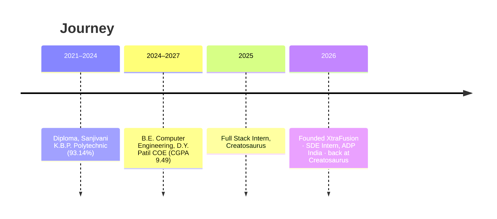

# Om Salunke

### Software Engineer · Backend & Distributed Systems · AI Developer Tooling

**I don't fix bugs. I build the tools that stop them from showing up.**

Founder of the XtraFusion ecosystem — open-source tooling that makes AI coding agents faster, cheaper and safer.

  
  
  
  
  

  
  
  
  
  

---

## 👋 About me

Backend by trade, tool-builder by instinct. If a workflow annoys me twice, it gets its own npm package.

- 🏢 **Now:** Software Developer Intern at **Creatosaurus** (round two) — backend pipelines, scrapers and real-time data at scale
- 🏦 **Before:** 3-month SDE internship at **ADP India (Fortune 500)** — Python/Pydantic backend services, AWS, Amazon Q, Agile CI/CD
- ⚙️ **And before that:** Full Stack Intern at **Creatosaurus** — scraping pipelines ingesting **10,000+ records/day** on AWS EC2, Redis & BullMQ
- 🚀 **Side quest:** Founder of **XtraFusion** — four shipped products around MCP servers, AI agent memory and secrets management
- ⚔️ **Competitive programming:** LeetCode Knight, rating **1,857** (top ~6% globally), **645+** problems solved
- 🎓 **Education:** B.E. Computer Engineering, D.Y. Patil College of Engineering, Pune (CGPA **9.49**)

---

## 📊 At a glance

| 🧠 **99.98%** | ⚡ **~52 ms** | 📈 **10K+/day** | 🔐 **5K+/day** | 🏆 **Top 6%** |
|:---:|:---:|:---:|:---:|:---:|
| LLM prompt tokens saved by Codebase Trainer vs raw repo dumps | Hybrid BM25 + vector search latency, fully offline | Records ingested by pipelines I built at Creatosaurus | Secret-retrieval requests served by XtraSecurity | LeetCode contest standing worldwide |

---

## 🚀 What I've built

<table>
<tr>
<td width="50%" valign="top">

### 🧩 [Codebase Trainer](https://github.com/om0852/codebase-trainer)
  

**Local codebase intelligence engine for Cursor, Claude Code & VS Code.**

- Indexes a repo's AST, imports and call graph so agents get ~1.5k targeted tokens instead of multi-million-token dumps
- Hybrid retrieval: Okapi BM25 + local 128-d embeddings + PageRank, fused with Reciprocal Rank Fusion
- API contract drift detection, change-impact analysis, SARIF output for GitHub Actions
- 100% local — no API keys, no code leaves the machine

`npx codebase-trainer init` · [Live site](https://codebase-trainer.vercel.app)

</td>
<td width="50%" valign="top">

### 🔐 [XtraSecurity](https://xtrasecurity.in/)
  

**Zero-knowledge environment variable & secrets manager.**

- Replaces `.env` files with client-side encrypted vaults, RBAC, JIT access and tamper-evident audit logs
- `xtra run` CLI injects secrets into process memory at startup — zero disk footprint
- REST backend serving 5,000+ retrievals/day with Redis caching; integrations for GitHub, AWS, Vercel, Slack

[Platform](https://xtrasecurity.in/) · [Docs](https://xtrasecurity.in/docs)

</td>
</tr>
<tr>
<td width="50%" valign="top">

### 🧠 [XtraContext](https://xtracontext.vercel.app/)
  

**Persistent architectural memory for AI coding agents.**

- Fixes "AI amnesia": Cursor, Windsurf and Claude log decisions to a shared vault and recall them in later sessions
- Semantic search over architectural decisions, bug fixes and patterns; syncs across IDEs and CI
- Real-time telemetry dashboard with workspace-scoped API keys

[Live app](https://xtracontext.vercel.app/) · [Architecture](https://xtracontext.vercel.app/dashboard/docs)

</td>
<td width="50%" valign="top">

### 🌐 [XtraDevPilot](https://github.com/om0852/XtraDevPilot)
  

**Local-first bridge between your real Chrome and your AI IDE.**

- Connects Claude Desktop, Cursor and Antigravity to the user's authenticated browser over local loopback via MCP
- 33 tools: live DOM extraction, one-click Playwright test synthesis, token-optimized DOM (up to 94% fewer tokens), runtime JS eval
- Code never leaves the machine

[Repo](https://github.com/om0852/XtraDevPilot) · [Portal](https://xtradevpilot.vercel.app/)

</td>
</tr>
</table>

<b>More projects</b>

- 🎨 **[Multi-UI](https://github.com/om0852/multi-ui)** — 30+ animated, type-safe React components (React 19, Next.js 15, Framer Motion) with live docs
- 👁️ **XtraTyping** — browser typing trainer using MediaPipe face mesh for real-time Eye Aspect Ratio blink detection

---

## 💼 Experience

| When | Where | What |
|---|---|---|
| **Oct 2026 – Present** | **Creatosaurus** · Software Developer Intern | Back for a second stint on the backend and data-pipeline side |
| **Jul 2026 – Sep 2026** | **ADP India (Fortune 500)** · Software Developer Intern | Production backend services in Python/Pydantic; Agile delivery with Amazon Q, AWS, Jira, Bitbucket |
| **Jul 2025 – Jul 2026** | **Creatosaurus** · Full Stack Developer Intern | Social Listening feature: multi-platform scrapers + Node.js pipelines, 10K+ records/day, AWS EC2 · PM2 · Redis · BullMQ · MongoDB |
| **Oct 2025 – Apr 2026** | **Eqvisor** · Frontend Developer | Investment analytics UI and type-safe component libraries |

---

## 🛠️ Tech stack

**Languages**
 

**Backend & Data**
 

**Frontend**
 

**AI & Developer Tooling**
 

**Cloud & DevOps**
 

---

## 🏆 Highlights

- ⚔️ **LeetCode Knight** — rating 1,857, global rank 54,292 / 890,724; 645+ solved (443 E · 166 M · 36 H)
- 🥇 **1st place**, Code War · 🥉 **3rd place**, Techbliz Hackathon · **5th**, Avinay Hackathon (JSPM, Pune)
- ☁️ AWS Cloud Practitioner Essentials
- 📦 Published open-source npm package used with Cursor, Claude Code and VS Code

---

## 📈 GitHub

  
  
   
  

---

### 💬 Let's talk

Real-time pipelines · MCP servers · retrieval for code agents · zero-knowledge secrets

*Shipping > talking. But I do reply to emails.*

**📫 salunkeom474@gmail.com** · [LinkedIn](https://www.linkedin.com/in/om-salunke-81bb63292/) · [Portfolio](https://salunkeom.netlify.app/)

